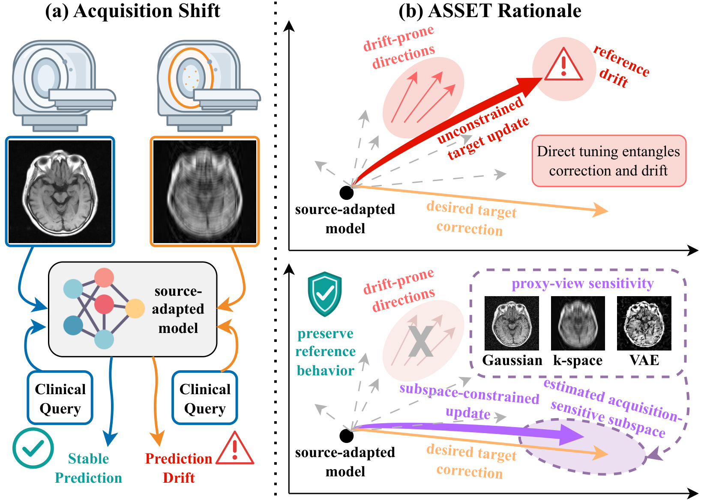

# ASSET: Acquisition-Sensitive Subspace Estimation for Test-Time Adaptation of Medical VLMs

[](https://neurips.cc/virtual/2026/poster/153026)



## 📖 Overview

This repository contains the official implementation of our NeurIPS 2026 paper **ASSET**, a test-time adaptation method for medical vision-language models under acquisition shift. From a small labeled target support set, ASSET estimates an acquisition-sensitive parameter subspace and adapts the source-adapted model only within this subspace.

### Key Highlights

- 🎯 **Acquisition-Sensitive Subspace**: Estimates the parameter directions responsible for acquisition-shift failures from prediction and gradient changes under proxy views
- 🔒 **Constrained Adaptation**: Updates the model only within this subspace through iterative estimate-and-update rounds
- 📈 **Consistent Gains**: Improves accuracy under acquisition-quality shift by 2.62% on average across datasets and backbones, while preserving no-shift performance
- 💪 **Severe Shifts**: Improves accuracy by 4.12% under the strongest acquisition-quality shifts
- 🩻 **Real Protocol Shift**: Improves accuracy by 2.98% on a real chest X-ray shift from PA to AP views
- 🌐 **Beyond Medical Imaging**: Improves strongest-shift accuracy in 5 of 6 corruption families of the Visual Robustness Benchmark

## 🚀 Quick Start

### Installation

ASSET requires Linux, a CUDA GPU, Python 3.11 or 3.12, and [uv](https://docs.astral.sh/uv/).

```bash
cd ASSET
uv sync --extra lora --locked
```

MedGemma-4B-IT, RadImageNet-VQA, and GMAI-MMBench are gated on Hugging Face. Accept their terms and log in:

```bash
uv run hf auth login
```

## 📚 Usage

### 1. Prepare Data

Download SLAKE and build its acquisition-shift tasks:

```bash
uv run asset prepare slake
```

The other datasets are `radimgnet`, `gmai`, `mimic`, and `vrb`. All tasks are listed in the [data README](src/asset/data/README.md).

### 2. Train the Source Model

Train the source-adapted LoRA model:

```bash
CUDA_VISIBLE_DEVICES=0 uv run llamafactory-cli train configs/lora/internvl.yaml \
  dataset=slake output_dir=outputs/lora/internvl_slake
```

Use `configs/lora/medgemma.yaml` for MedGemma-4B-IT and `configs/lora/internvl_vrb.yaml` for `vrb`.

### 3. Adapt with ASSET

Adapt the source model to a target shift:

```bash
uv run asset adapt \
  --adapter outputs/lora/internvl_slake \
  --task data/tasks/slake_ct_gaussian \
  --output outputs/asset/internvl_slake_ct_gaussian
```

Each round is saved as a LoRA adapter in `round_01` to `round_05`, and `log.jsonl` records the losses. Run `uv run asset adapt --help` for the variants and ablation options.

### 4. Evaluate

```bash
uv run asset evaluate \
  --adapter outputs/asset/internvl_slake_ct_gaussian/round_05 \
  --task data/tasks/slake_ct_gaussian
```

`asset evaluate` reports the accuracy under every condition of the task, together with the no-shift, average, and strongest-shift accuracy. Pass `--adapter outputs/lora/internvl_slake` to evaluate the source model.

## 📝 Citation

If you find this work useful, please cite our paper:

```bibtex
@inproceedings{zhang2026asset,
  title     = {{ASSET}: Acquisition-Sensitive Subspace Estimation for Test-Time Adaptation of Medical {VLMs}},
  author    = {Zhang, Mohan and Tan, Zhen and Sui, Songyuan and Chen, Tianlong},
  booktitle = {Advances in Neural Information Processing Systems},
  year      = {2026}
}
```

## 🙏 Acknowledgments

We thank the open-source community for the models, datasets, and tools used in this work:
- **OpenGVLab** for InternVL3.5-8B
- **Google** for MedGemma-4B-IT
- The authors of **SLAKE**, **RadImageNet-VQA**, **GMAI-MMBench**, **MIMIC-CXR**, **MIMIC-CXR-VQA**, **VQAv2**, and the **Visual Robustness Benchmark** for releasing their datasets
- **LLaMA-Factory** for the fine-tuning framework
- **Hugging Face** for hosting the models and datasets

## 📄 License

This project is released under the [MIT License](LICENSE).
